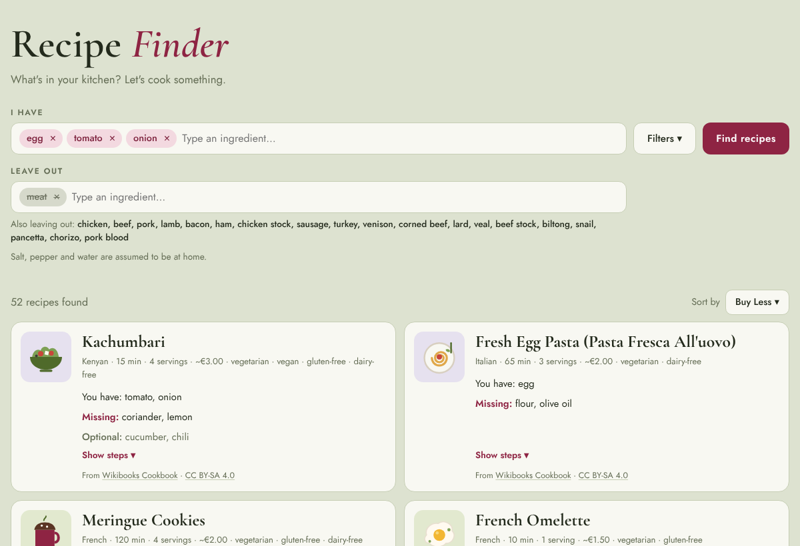

# Recipe Finder 🍲

Type what's in your kitchen and find something you can cook tonight.

### 👉 [Try it live](https://alisiamouka.github.io/recipe-finder/)



## What it does

- **75 recipes** from 23 cuisines, from Spanish Tortilla to Indonesian Rendang, each with
  cooking steps.
- **I have:** type your ingredients (with suggestions as you go), and the recipes you can
  cook with the fewest extra purchases come first. Each card shows what you have and
  what's missing.
- **Leave out:** hide anything you don't want. Leave out a whole family, like "meat" or
  "cheese", and every member goes with it.
- **Filters:** vegetarian, vegan, gluten-free and dairy-free.
- **Sort by:** Buy Less, Use Most, Quickest, or Cheapest (per serving).
- **Smart matching:** cheddar counts for a recipe that just says "cheese", and zucchini
  finds courgette recipes.
- **Browse everything:** with nothing typed, you see every recipe, A to Z.

Prices are rough estimates in euros. Always check ingredient labels if you have allergies.

## How it's organized

The code is set up like a kitchen, with each part doing one job:

| File | Kitchen role | What it does |
|---|---|---|
| `recipes.js` | 🥫 The pantry | All recipe information: ingredients, steps, labels, time, price |
| `ingredients.js` | 📖 The reference book | Ingredient families (cheese, meat, …) and other names (zucchini = courgette) |
| `matcher.js` | 👩‍🍳 The cook | Picks, filters and sorts recipes. It knows nothing about the page |
| `app.js` | 🧑‍🍳 The waiter | Connects what you click and type to the cook, and shows the results |
| `index.html`, `style.css` | 🍽️ The dining room | What the page looks like |
| `images/illustrations/` | 🎨 | The food drawings on each recipe card |
| `tests/` | ✅ | Checks that keep everything working |

## Changing things

**Add a recipe:** copy an existing recipe in `recipes.js` and change the details. Ingredient
names are lowercase and singular ("tomato", not "Tomatoes").

**Change a recipe's drawing:** change its `illustration` word in `recipes.js` to one of the
names in `images/illustrations` (without `.svg`).

**Run the checks** (needs [Node.js](https://nodejs.org)):

```
npm test
```

Every check is a plain sentence, like *"no vegetarian recipe contains meat or fish"*, so if
one fails, it tells you exactly what's wrong. GitHub also runs the checks automatically on
every pull request.

## Recipe sources and licenses

- Recipes marked **"From Wikibooks Cookbook"** are adapted from the
  [Wikibooks Cookbook](https://en.wikibooks.org/wiki/Cookbook:Table_of_Contents) and
  shared under [CC BY-SA 4.0](https://creativecommons.org/licenses/by-sa/4.0/). Each card
  links to its original page. You're welcome to reuse them under the same license.
- The other recipes were written for this project.

## Plans

What's built, what's next, and the decisions behind them are in [PLAN.md](PLAN.md).
